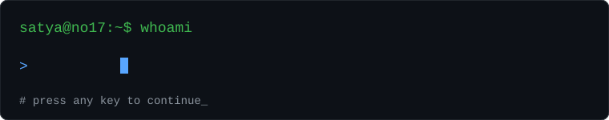

<div align="center">





<br/>

[](https://www.linkedin.com/in/satyam-kumar-929b97325/)
[](https://www.instagram.com/satya_is_okay/)
[](https://github.com/satya-no17)

</div>

<br/>

```text
+--------------------------------------------------------------+
|  $ cat ~/satya/profile.txt                                   |
|                                                              |
|   name     : Satyam Kumar                                    |
|   user     : satya-no17                                      |
|   role     : Full-stack developer                            |
|   focus    : Next.js . Node . MongoDB . Redis                |
|   status   : building & learning                             |
+--------------------------------------------------------------+
```

<div align="center">
  
</div>

<br/>

```text
$ tree ~/skills
.
|-- frontend
|   `-- React . Next.js . TypeScript . Tailwind . HTML . CSS
|-- backend
|   `-- Node . Express . MongoDB . Redis
|-- systems
|   `-- C++ . Python . Linux . Git
`-- deploy
    `-- Vercel
```

<div align="center">


</div>

<br/>

```text
$ ls ~/projects
```

<div align="center">

<a href="https://github.com/satya-no17/satpat"></a>
<a href="https://github.com/satya-no17/Sat_short"></a>
<br/>
<a href="https://github.com/satya-no17/sat-draw"></a>
<a href="https://github.com/satya-no17/Profile-Io"></a>
<br/>
<a href="https://github.com/satya-no17/Search_Engine"></a>
<a href="https://github.com/satya-no17/Joke-SDK"></a>

</div>

<br/>

```text
$ git stats --me
```

<div align="center">


</div>

<br/>

```text
$ open --links
  linkedin   https://www.linkedin.com/in/satyam-kumar-929b97325/
  instagram  https://www.instagram.com/satya_is_okay/
  github     https://github.com/satya-no17
```

<div align="center">

```text
satya@no17:~$ logout
# thanks for visiting. see you in the commits.
```

</div>
